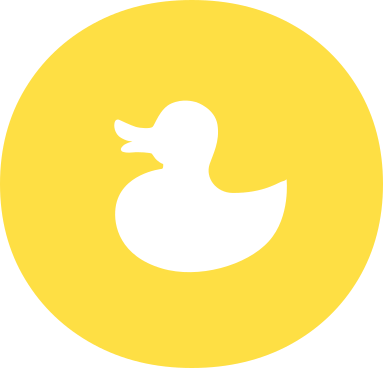
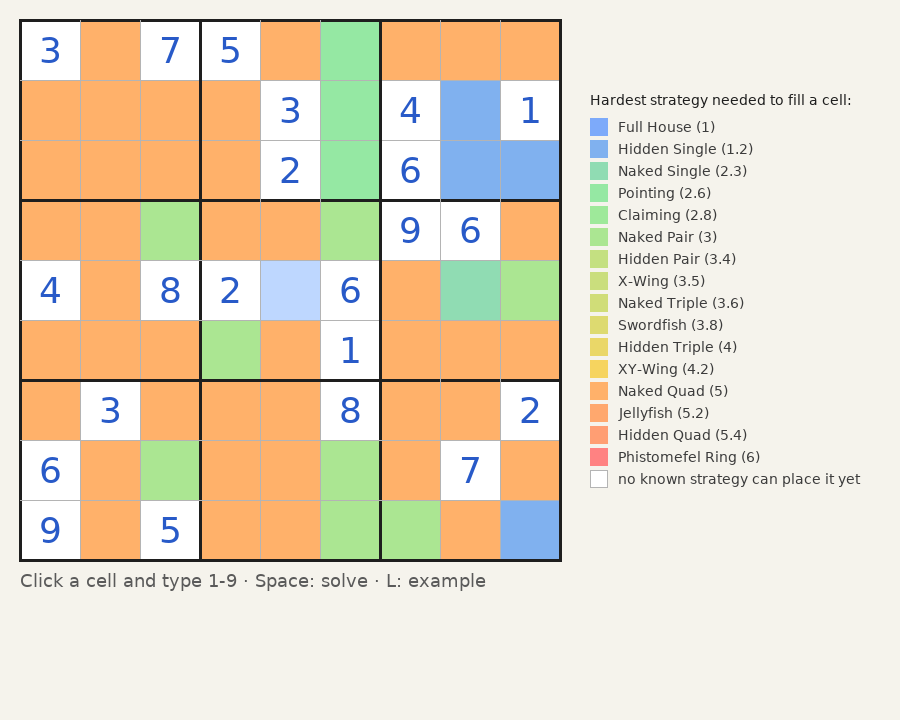
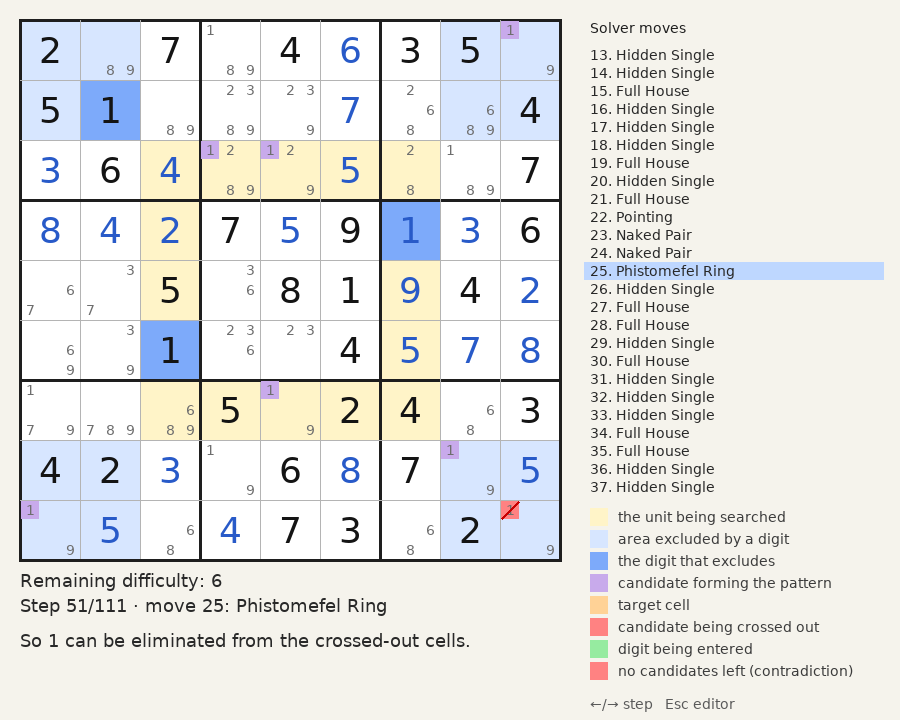

<div align="center">

# Sudku Creatr

**Build sudoku puzzles that a human can solve, and see exactly how.**

[](https://github.com/topics/duckling-lang)


</div>

## Overview

Sudoku Creator is a desktop editor for designing sudoku puzzles. Its solver works like a person
does: it applies named strategies, from Hidden Single up to Jellyfish and Phistomefel's ring,
always picking the easiest one that makes progress. This lets the editor show:

- **while you edit**, a heatmap of the hardest strategy needed to fill each cell, so you can see
  how difficult the puzzle is and which cells cannot be reached by logic yet;
- **after you press Space**, the whole solution, step by step, with every move explained in words
  and highlighted on the board.

It ships with example boards that show each strategy, and can generate random new puzzles.

## Screenshots

| Editor | Solver |
| :---: | :---: |
|  |  |
| Colours show the hardest strategy each cell needs. | Each move of the solution, explained and highlighted. |

## Installation

### 1. Duckling

The project builds with the
[weekly development release](https://github.com/ducktype-org/duckling/releases/tag/dev-weekly) of
[Duckling](https://github.com/ducktype-org/duckling). To install it on Linux:

```sh
curl -LO https://github.com/ducktype-org/duckling/releases/download/dev-weekly/duckling-dev-linux-x86_64.tar.gz
tar xzf duckling-dev-linux-x86_64.tar.gz
./duckling-dev-linux-x86_64/install.py
```

The installer puts Duckling in `~/.local/share/duckling` and adds the `duck` command to your
`PATH`. Open a new terminal afterwards. A `macos-arm64` package is also published.

### 2. SDL2

The app needs the SDL2 and SDL2_ttf libraries:

```sh
sudo apt install libsdl2-dev libsdl2-ttf-dev   # Debian, Ubuntu
sudo dnf install SDL2-devel SDL2_ttf-devel     # Fedora
brew install sdl2 sdl2_ttf                     # macOS
```

## Running

From the repository root:

```sh
duck run
```

The app opens in the editor with an empty board:

| Key | Action |
| --- | --- |
| Click, arrow keys | select a cell |
| `1`–`9` / `0`, Backspace | enter / clear a digit |
| `L` | load an example (`1`–`9`) or a random puzzle (`R`) |
| Space | browse the solution (←/→ to step, Esc to return to the editor) |
| Esc | quit (in the editor) |

For debugging without a window, set `SUDOKU_HEADLESS`: an 81-character board (`.` for empty
cells) prints how it is solved, and any other value runs the self-tests. See
[`src/headless.dk`](src/headless.dk) for all modes.
